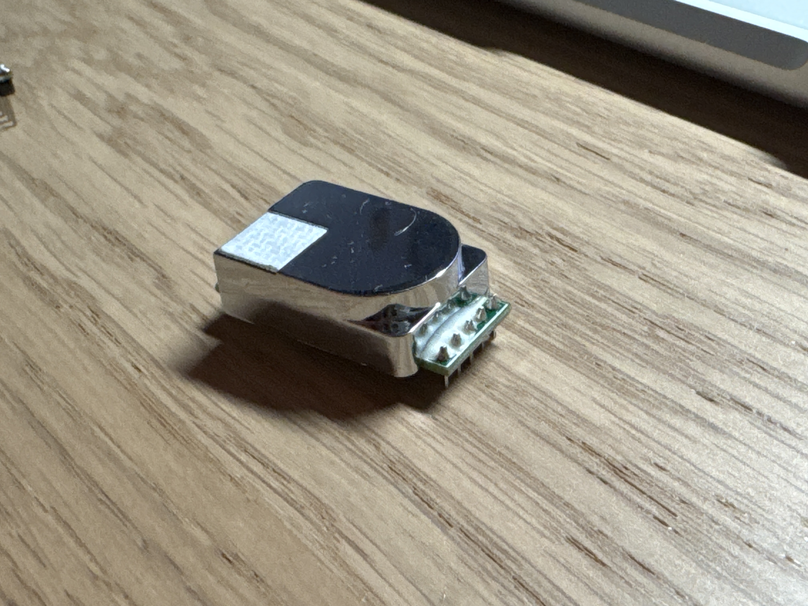
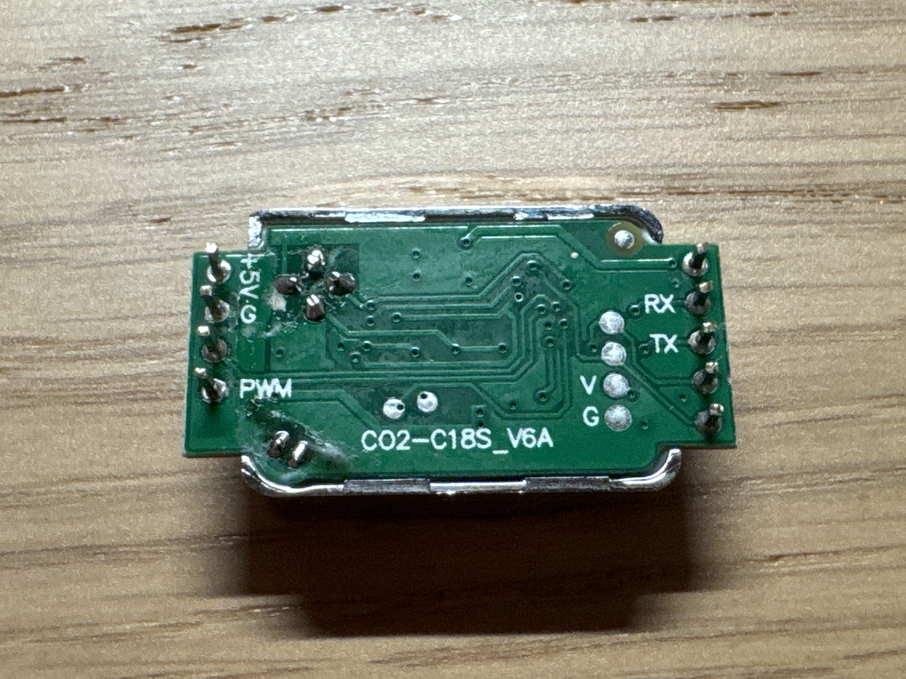

# ESPHome Cubic CO₂ — `CO2-C18S` / `C18S_V6A`

ESPHome component for the **Cubic CO2-C18S** NDIR module found inside cheap Tuya
CO₂ monitors (e.g. **Moes BSS-X-CO2-U**). No built-in ESPHome platform speaks its
protocol so this component exists. The module streams frames on its own instead of
answering queries. Stock firmware, nothing to flash on the module.

```
[D][cubic_co2:058]: CO2: 847 ppm
[D][cubic_co2:058]: CO2: 851 ppm
```

## Hardware

 

Modules labelled **`CO2-C18S`** or **`CO2-C18S_V6A`**. They ship in many Tuya-based
CO₂ monitors under different brand names — Wi-Fi or BLE host makes no difference.
Broken units are a cheap source: the radio often dies while the NDIR module keeps
working.

| Pin | Name | Meaning |
|---|---|---|
| 1 | `V` | Supply **5 V** |
| 2 | `G` | Ground |
| 3 | `TX` | UART out, 3.3 V TTL → ESP RX |
| 4 | `RX` | UART in, optional (this component never sends) |
| 5 | `PWM` | Unused |

Logic is 3.3 V, so no level shifter is needed — only the supply is 5 V.

### Wiring

| C18S | ESP32 |
|---|---|
| `V` | `5V` |
| `G` | `GND` |
| `TX` | `GPIO18` (your `rx_pin`) |
| `RX` | `GPIO19` (optional) |

Avoid `GPIO16`/`GPIO17` on ESP32-C6 — USB console pins. Otherwise any free GPIO works.

## Installation

```yaml
external_components:
  - source:
      type: git
      url: https://github.com/w-wie-waldi/esphome-cubic-co2-c18s
      ref: main
    components: [cubic_co2]
```

Local variant: copy `components/cubic_co2/` next to your YAML and use
`type: local` with `path: components`. Restart the dashboard/container afterwards.

## Configuration

```yaml
uart:
  - id: co2_uart
    rx_pin: GPIO18
    tx_pin: GPIO19
    baud_rate: 9600

sensor:
  - platform: cubic_co2
    uart_id: co2_uart     # required once a second UART exists
    name: "CO2"
```

Standard sensor options and filters work. Rate limiting goes through the normal
filter system, not through an `update_interval` — with a fixed 3 s sensor cycle any
configured interval could only be hit in multiples of 3 s:

```yaml
    filters:
      - throttle: 30s
      - offset: -35       # single-point calibration, see below
```

## Module-specific gotchas

- **Constant value like 518 ppm?** Wrong byte offset. The frame is
  `5C 00 01 02 HI LO XOR`; bytes 3–4 are constant (`02 06`) and the measurement is
  `bytes[4] << 8 | bytes[5]`.
- **Entity stays `unknown`, no `[D][cubic_co2]` lines?** A `uart: debug:` block with
  `dummy_receiver: true` swallows every incoming byte. Remove it while the component
  is active.
- **`Reading from UART timed out`?** That is the built-in `cm1106` platform talking to
  a sensor that never answers. This module only streams.
- **`Too many candidates found for 'uart_id'`?** Give every UART sensor an explicit
  `uart_id:`.
- **Weak USB port or long thin wires?** The IR emitter draws current spikes; the
  resulting dropouts look like protocol errors.

## Companion board: the T/RH sensor is an SHT4x

The same teardown yields a 4-pin I²C board (`XZ-JC001-B`: `SDA`/`SCL`/`3V3`/`GND`).
It is a **Sensirion SHT4x at `0x44`** — no custom component needed, ESPHome has it
natively. Tell-tale sign: the `sht3xd` platform fails with
`Failed to set heater mode` although the address scans fine.

```yaml
i2c:
  sda: GPIO4
  scl: GPIO5

sensor:
  - platform: sht4x
    address: 0x44
    temperature:
      name: "Temperatur"
    humidity:
      name: "Luftfeuchtigkeit"
    update_interval: 30s
```

With both boards on one ESP32 you get CO₂ + temperature + humidity from a single
salvaged monitor. See [examples/air-sense-co2.yaml](examples/air-sense-co2.yaml).

## Calibration

The module appears to run automatic baseline correction, drifting towards ~400 ppm
during long fresh-air periods.

- **Reference test:** outside for 20–30 min should settle near 405–430 ppm.
- **Offset:** reads 540 ppm outdoors → `- offset: 140`. Single point, good enough
  for room monitoring.
- **Placement:** air the module gets matters more than any offset. Behind furniture
  or in a closed box, readings lag badly.

## Protocol

Frame layout, checksum and why `cm1106`/`hc8` fail: [docs/protocol.md](docs/protocol.md).

## License

MIT
